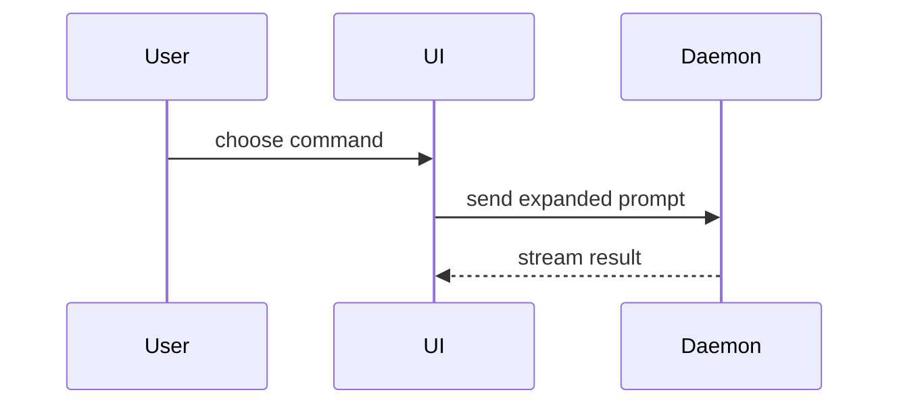

用这个模板来写 PR 正文：

```markdown
## Summary

<diagram, diff-sketch, or tree>

## Evidence

- **Before:** <screenshot/output/failing test run>
  **After:** <screenshot/output/passing test run>

## Merge Danger

**Door:** <one-way or two-way>

<optional: description>

**Blast Radius:** <one-word description>

<optional: potential ramifications of merge>
```

## 各章节

跳过所有开场白，行文保持简短。使用 `GLOSSARY.md` 里用户的领域语言。

### Summary

挑最小的那个视图，只要能说清要点就行。

- 用伪代码展示逻辑或算法：

```text
on(save)
  if content is unchanged
    return cached result
  write new content
  return fresh result
```

- 用调用树展示运行时控制流：

```text
submitForm
  createSession
    persistPrompt
    launchAgent
  navigateToSession
```

- 用组件树展示 UI 结构，包含要紧的状态和模块边界：

```text
<SessionPage> (apps/example/src/routes/session.tsx)
  useSessionEvents()
  <SessionToolbar>
    <RunSkillButton> (packages/ui)
```

- 用浅层文件树展示文件职责或大范围重构：

```text
src/
├── commands/       # parses user actions
├── sessions/       # owns session state
└── transport/      # sends API requests
```

- 用 Mermaid 展示组件交互、控制流或数据流：



- 当重点是「变了什么」、而周围的形状已经存在时，用 `diff`。让 diff 的形状贴合主题。

组件改动：

```diff
 <SessionPage>
   useSessionEvents()
   <SessionToolbar>
+    <RunSkillButton />
   <SessionTimeline>
+    <SkillResultCard />
```

文件布局改动：

```diff
 src/
 ├── commands/
+│   └── show-me.ts       # expands the slash command
 ├── sessions/
-└── transport.ts
+└── transport/
+    ├── client.ts
+    └── stream.ts
```

调用树或调用栈改动：

```diff
 submitForm
   createSession
     persistPrompt
+    expandSkillMention
     launchAgent
-  navigateToSession
+  navigateToSession
+    subscribeToEvents
```

状态或控制流改动：

```diff
 on(save)
-  write content
+  if content is unchanged
+    return cached result
+  write new content
+  invalidate cache
```

- 当大部分内容都是新增的、省略上下文会隐藏归属或顺序、或者用户需要一个可复制的目标形状时，把整块都展示出来：

```ts
function expandSkill(command: string): string {
  const skillName = command.slice(1);
  return `use the ${skillName} skill`;
}
```

#### 指导

把每个可视化放在它所支撑的那段短文字旁边。只保留回答用户当前问题、或呈现当前讨论点待决选项所必需的调用、文件、props、状态和边界。

这些你可以用其中一个，也可以用几个，但不太可能全用上。自己判断，别把用户淹了。

### Evidence

证明改动确实生效的实证。展示前后对比。

截图是 S 级——前提是环境支持，且改动是视觉上的。

基于执行的实证是 A 级。测试结果、控制台输出。用伪代码展示那条现在先失败、后通过的测试。

### Merge Danger

说明这是单向门（one-way door）还是双向门（two-way door）。双向门你能走回去，单向门不能。回滚成本低的 PR 风险更低。涉及破坏性操作或难以逆转的决策的改动，就是单向门。

影响半径（blast radius）是这个 PR 引入的改动可能造成的影响或波及范围。把所有可能性都考虑进去。例子有布局抖动、对使用方造成破坏、移动端响应式问题等。
